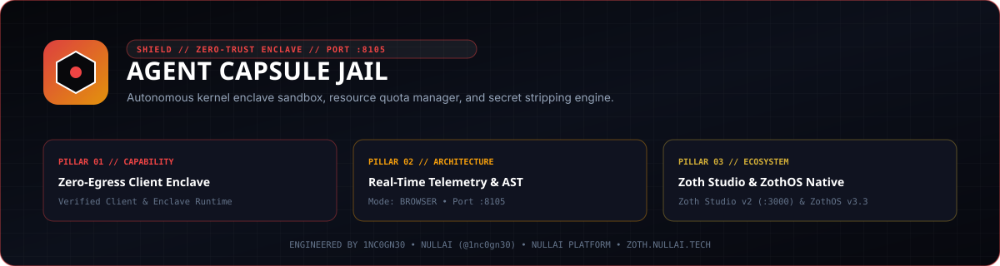

# Agent Capsule Jail



**Agent Capsule Jail** (`agent-capsule-jail`) is a zero-dependency Python 3.10+ ephemeral execution sandbox, POSIX `resource` quota enforcer, secret-stripping runner, and HTTP enclave server (`127.0.0.1:8105`) for AI agents. It isolates untrusted commands and Python scripts inside `bubblewrap` (`bwrap`) Linux namespaces with network isolation by default, strict `RLIMIT_AS` / `RLIMIT_CPU` / `RLIMIT_NPROC` / `RLIMIT_FSIZE` ceilings, and post-run filesystem diffing.

- **Zoth Studio v2 Dossier**: [https://zoth.nullai.tech/tools/agent-capsule-jail](https://zoth.nullai.tech/tools/agent-capsule-jail)
- **Repository**: [https://github.com/1nc0gn30/agent-capsule-jail](https://github.com/1nc0gn30/agent-capsule-jail)
- **Default Loopback Endpoint**: `http://127.0.0.1:8105`

---

## Overview

- **Linux Namespace Enclave (`CapsuleRunner`)**: Uses `bwrap` (`--unshare-all`, read-only `/usr`, `/bin`, `/lib`, isolated `/tmp` and scratch workdir) with network unshared unless `--allow-network` is explicitly passed. Refuses remote execution when `bwrap` is absent unless `CAPSULE_ALLOW_UNSANDBOXED=1` is set by the operator.
- **POSIX Resource Quotas (`ResourceLimits`)**: Enforces wall/CPU timeout (`timeout_sec`), address-space ceiling (`memory_mb`), max child processes (`max_procs`), and max file write size (`max_fsize`).
- **Environment Sanitization**: Strips host environment variables (`OPENAI_API_KEY`, `AWS_SECRET_ACCESS_KEY`, SSH/GPG sockets, tokens) before spawning the capsule, passing only explicitly allowlisted variable names (`--env`).
- **Authenticated `/api/exec` Endpoint**: Generates a per-user secret token stored in `~/.config/agent-capsule-jail/token` (`0600`) required via `X-Capsule-Token` header on remote execution calls.
- **Forensic Filesystem Diffs**: Computes created, modified, and deleted files in the ephemeral scratch directory before destroying it (or optionally committing approved artifacts with `--commit --dest <dir>`).

---

## Architecture

```text
Agent / Operator Request (CLI or POST /api/exec + X-Capsule-Token)
        │
        ▼
CapsuleRunner
   ├── Environment Scrubber (allowlist-only env vars)
   ├── Scratch Workspace + Pre-Snapshot Hash Tree
   ├── bwrap Namespace Jail (--unshare-all, --die-with-parent) + POSIX rlimits
   └── Post-Snapshot Diff + RSS/CPU Telemetry ──► Flight Recorder (:8104)
```

---

## Quickstart

```bash
git clone https://github.com/1nc0gn30/agent-capsule-jail.git
cd agent-capsule-jail
python3 -m pip install -e .

# Start the HTTP Cockpit & Enclave API on 127.0.0.1:8105
agent-capsule serve --host 127.0.0.1 --port 8105
```

Or run directly from the checkout:

```bash
python3 server.py --port 8105
```

Open `http://127.0.0.1:8105` in your browser (the server injects the local `capsule-token` meta tag for same-host browser sessions).

---

## CLI & ZothOS v3.4.0 Integration

`agent-capsule` (`./bin/agent-capsule` and `./bin/agent-capsule-jail-tui`) executes isolated commands directly or inspects the `:8105` daemon:

```bash
# Inspect sandbox mode (bwrap) and daemon telemetry
agent-capsule --status
agent-capsule --json
agent-capsule status --port 8105 --json

# Print the X-Capsule-Token for authenticated /api/exec clients
agent-capsule token

# Execute an isolated command (network disabled, 10s timeout, 256 MB ceiling)
agent-capsule exec --timeout 10 --memory 256 --json -- python3 -c "print(2 ** 32)"

# Execute a local Python script inside the ephemeral scratch jail
agent-capsule exec --script path/to/script.py --max-procs 16 --max-fsize 10
```

---

## REST API Reference

`POST /api/exec` enforces both local-origin CSRF checks and `X-Capsule-Token` authentication (`agent-capsule token`).

| Method | Endpoint | Description |
| :--- | :--- | :--- |
| `GET` | `/` | Web enclave workstation (`public/index.html`) |
| `GET` | `/health`, `/api/health` | Service health, active `sandbox` mode (`bwrap`), and capsule count |
| `GET` | `/api/stats` | Cumulative capsules, successes, timeouts, OOM kills, CPU ms, and Flight Recorder events |
| `GET` | `/api/capsules?limit=50` | Recent capsule execution records and forensic diffs |
| `POST` | `/api/exec` | Execute command/script (`X-Capsule-Token` header; JSON body `{"command", "script", "timeout_sec", "memory_mb", "allow_network"}`) |

---

## Testing & Verification

```bash
PYTHONPATH=src python3 -m pytest -q
./bin/agent-capsule --help
./bin/agent-capsule --json
```

---

## Support & License

100% free and open-source software under the MIT License.

- Optional support: [Buy Us a Coffee via Stripe](https://buy.stripe.com/3cIfZg27PdKo2D64Ocfw40X)
- Engineered by **1nc0gn30** (`@1nc0gn30`, [https://1nc0gn30.si](https://1nc0gn30.si)) • **NullAI** ([https://nullai.tech](https://nullai.tech))
