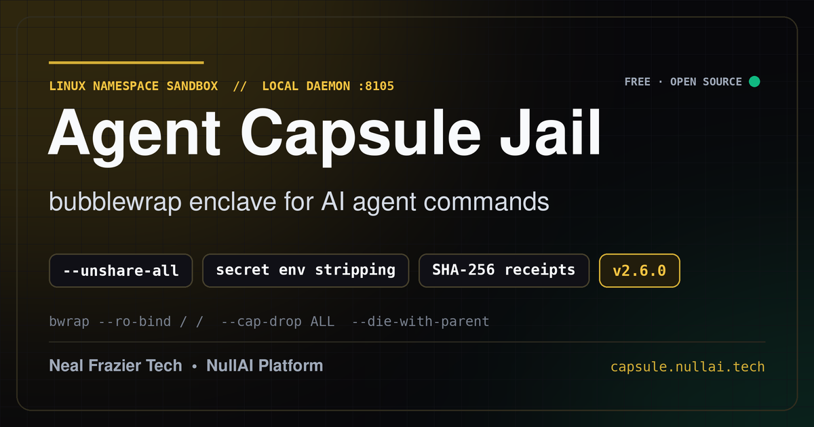

# Agent Capsule Jail (`v2.6.0`)



**Agent Capsule Jail** (`agent-capsule-jail`) is a zero-dependency Python 3.10+ ephemeral Linux namespace sandbox, cgroup/rlimit resource quota enforcer, environment secret scrubber, stdio MCP server, and authenticated loopback HTTP enclave (`127.0.0.1:8105`) for AI agents.

- **Zoth Studio v2 Route**: [https://zoth.nullai.tech/tools/agent-capsule-jail](https://zoth.nullai.tech/tools/agent-capsule-jail)
- **Repository**: [https://github.com/1nc0gn30/agent-capsule-jail](https://github.com/1nc0gn30/agent-capsule-jail)
- **Default Loopback Endpoint**: `http://127.0.0.1:8105` (on-demand local daemon)

---

## What It Does & How It Works

- **Linux Namespace Jail (`bubblewrap`)**: Executes untrusted commands and Python scripts with `bwrap --ro-bind / / --dev /dev --proc /proc --tmpfs /tmp --tmpfs /home --tmpfs /root --tmpfs /run --bind <scratch> <scratch> --chdir <scratch> --unshare-all --as-pid-1 --die-with-parent --new-session --cap-drop ALL`. Refuses execution when `bwrap` is absent unless `CAPSULE_ALLOW_UNSANDBOXED=1` is explicitly set by the host operator.
- **Per-Capsule Resource Quotas**: Enforces wall/CPU timeouts (`timeout_sec`, `0.5–60s`), virtual/cgroup memory ceilings (`memory_mb`, `32–4096 MB`, classifying `MemoryError`/OOM as `oom_killed`), per-capsule process limits (`max_procs`, `1–512`, enforced via `systemd-run --user --scope -p TasksMax=` when user cgroup v2 is available, falling back to `prlimit --nproc`), and file write caps (`max_file_size_mb`, `1–1024 MB`). Per-capsule CPU and peak RSS are measured via `os.wait4()` (never cumulative server totals).
- **Environment Sanitization & Network Gating**: Scrubs sensitive host environment variables (`*_KEY`, `*_TOKEN`, `*_SECRET`, `*_PASSWORD`, SSH/GPG sockets) even when requested via `allowed_env` (bypass requires host `CAPSULE_FORCE_SENSITIVE_ENV=1`) and passes a clean system `PATH`. Network namespaces stay unshared by default; `allow_network: true` returns HTTP `403` unless the daemon is started with `CAPSULE_ALLOW_NETWORK=1`.
- **Authenticated Loopback HTTP API (`127.0.0.1:8105`)**: Generates a per-user `0600` token (`~/.config/agent-capsule-jail/token`) required on `POST /api/exec` via `Authorization: Bearer <token>` or `X-Capsule-Token`. Enforces strict `Host` header validation, strict local `Origin` allowlisting with `Vary: Origin`, `403` on foreign `OPTIONS`/`POST`, zero CORS headers on `GET /`, and `Path.is_relative_to()` static containment.
- **SHA-256 Forensic Receipts & Filesystem Diffs**: Hashes the ephemeral scratch workspace before and after execution to produce exact created/modified/deleted file deltas and a deterministic `receipt_sha256` over `{capsule_id, command, exit_code, stdout, stderr, fs_diff}`. Optional commits require an explicit destination inside `CAPSULE_COMMIT_ROOTS`.
- **Dual-Theme & Embeddable UI**: Native Obsidian Dark and Editorial Ivory Light themes (`?theme=light|dark`, `prefers-color-scheme`, manual toggle) plus `?embed=1` mode for Zoth Studio v2 iframe integration. Real daemon errors (`401`/`403`/`400`) render honest `ERROR` states — zero simulated fallback on live errors.

---

## Architecture

```text
Agent / CLI / Studio / MCP Client (POST /api/exec + X-Capsule-Token or stdio MCP)
        │
        ▼
CapsuleRunner (src/agent_capsule_jail/capsule.py)
   ├── Strict Input Validation & Policy Gates (CAPSULE_ALLOW_NETWORK, SENSITIVE_PATTERNS)
   ├── Scratch Workspace + Pre-Run SHA-256 File Tree Snapshot
   ├── systemd-run cgroup TasksMax/MemoryMax + bwrap (--ro-bind / /, --unshare-all, --as-pid-1)
   └── os.wait4() Per-Run rusage + Post-Run fs_diff + SHA-256 Receipt ──► Flight Recorder (:8104)
```

---

## Quickstart

```bash
git clone https://github.com/1nc0gn30/agent-capsule-jail.git
cd agent-capsule-jail
python3 -m pip install -e .

# Start the authenticated loopback server & Web UI on 127.0.0.1:8105
python3 server.py --port 8105
```

Open `http://127.0.0.1:8105` in your browser (the same-origin HTML injects the local session token into `<meta name="capsule-token">` with zero CORS reflection).

---

## ZothOS CLI, TUI & MCP Commands

`agent-capsule-jail` (aliased as `agent-capsule` and `zoth-capsule-jail`) ships on PATH in ZothOS:

```bash
# Live daemon health, sandbox mode, and stats (never static placeholders)
agent-capsule-jail --status
agent-capsule-jail --json
agent-capsule-jail status --port 8105 --json

# Print active per-user X-Capsule-Token (for Studio God-Mode Deck or curl)
agent-capsule-jail token

# Execute an isolated command inside bwrap + cgroup/rlimit bounds
agent-capsule-jail exec --timeout 10 --memory 256 --max-procs 32 --json -- python3 -c "print(2 ** 32)"

# Execute a Python script inside an ephemeral scratch workspace
agent-capsule-jail exec --script path/to/script.py --max-procs 16 --max-fsize 10

# Launch live terminal telemetry dashboard
agent-capsule-jail-tui --once
agent-capsule-jail-tui --json

# Run zero-dependency JSON-RPC 2.0 stdio MCP server
agent-capsule-jail mcp
```

### MCP Tools (`agent-capsule-jail mcp`)

| Tool | Inputs | Output Fields |
| :--- | :--- | :--- |
| `capsule_jail_exec` | `command` or `script`, `timeout_sec`, `memory_mb`, `max_procs`, `max_file_size_mb`, `allowed_env`, `initial_files`, `allow_network` | `capsule_id`, `status`, `exit_code`, `stdout`, `stderr`, `duration_ms`, `cpu_time_user_s`, `cpu_time_sys_s`, `max_rss_kb`, `timed_out`, `memory_exceeded`, `fs_diff`, `sandbox_mode`, `pids_enforcement`, `receipt_sha256`, `flight_recorder_dispatched` |
| `capsule_jail_status` | *(none)* | `version`, `sandbox_mode`, `pids_enforcement`, `allow_network_enabled`, `daemon_online`, `stats` |

---

## REST API Reference (`127.0.0.1:8105`)

| Method | Endpoint | Auth / Policy | Description |
| :--- | :--- | :--- | :--- |
| `GET` | `/` | Same-origin only (zero CORS) | Dual-theme enclave workbench (`?theme=light\|dark`, `?embed=1`) |
| `GET` | `/health`, `/api/health` | Local allowlist + `Host` check | Daemon status, `version` (`2.6.0`), `sandbox` (`bwrap`), `pids_enforcement`, token requirement |
| `GET` | `/api/stats` | Local allowlist + `Host` check | Total capsules, successes, timeouts, OOM kills, CPU ms, Flight Recorder dispatch count |
| `GET` | `/api/capsules?limit=50` | `limit` validated `1..200` | Recent capsule execution records, diffs, and SHA-256 receipts |
| `POST` | `/api/exec` | `X-Capsule-Token` / `Bearer` + strict `Origin`/`Host` | Execute command/script inside ephemeral `bwrap` capsule |

---

## Testing & Verification

```bash
PYTHONPATH=src python3 -m pytest -q tests
agent-capsule-jail --version
agent-capsule-jail --status
agent-capsule-jail-tui --json
```

---

## Support & License

100% free and open-source software under the MIT License — zero paywalls, zero feature locks.

- Optional support (Stripe): [☕ Buy Us a Coffee](https://buy.stripe.com/3cIfZg27PdKo2D64Ocfw40X)
- Optional support (Solana): `GG2eQbVh8ut1BK6j1A2tz7pSySdLpD38BgyEhGcxdXoK` (`solana:GG2eQbVh8ut1BK6j1A2tz7pSySdLpD38BgyEhGcxdXoK`)
- Engineered by **Neal Frazier Tech (@1nc0gn30)** • **NullAI Platform** ([https://github.com/1nc0gn30/agent-capsule-jail](https://github.com/1nc0gn30/agent-capsule-jail) · [https://nullai.tech](https://nullai.tech))
